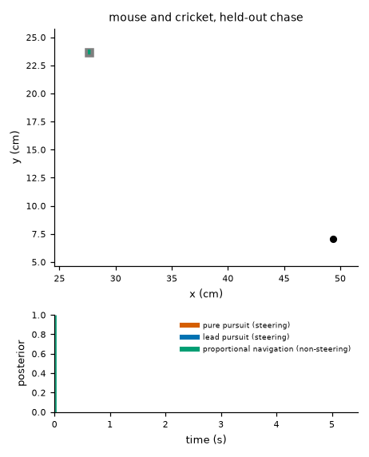
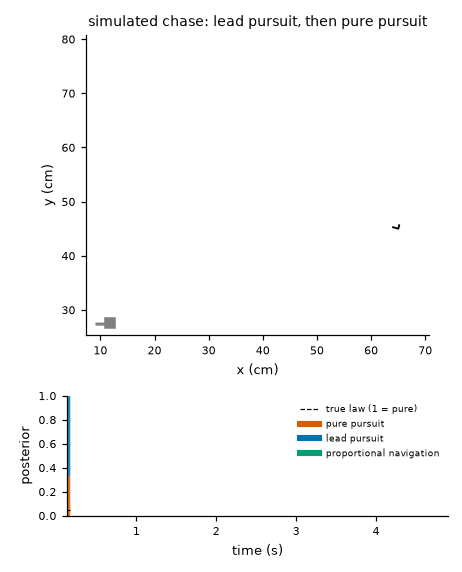
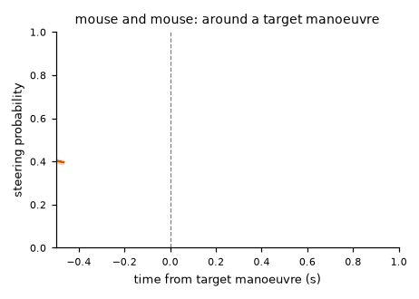

# markov-switching-pursuit

Anticipate or react? Mouse chases measured against the pursuit game.

A pursuer can run at where its target is or at where the target is going to be. This repository
fits a small library of guidance laws (pure pursuit, lead pursuit, proportional navigation) with
a hidden Markov model over the law index to tracked chases, validates the inference on simulated
chases where the truth is known, applies it to open recordings of mice chasing crickets and mice
chasing mice, and measures the chases against the pursuit game: how far the mouse's steering
sits from the optimal strategy, and whether the target responds to the pursuer.

What it finds: mouse steering toward a target is intermittent reactive pursuit. A pure-pursuit
state with a delay of 33 to 67 ms and a time constant of 0.15 to 0.18 s holds 15 to 23 percent
of a chase's frames on average by decoded state, the anticipatory laws collapse onto it, and the remaining frames show
no response to the target. A generic autoregressive switching model with no reference to the
target explains the head yaw as well as the law library and the body heading far better. Target
manoeuvres do not depend on the pursuer's state, and the chased mouse does not steer away from
the chaser in any form the evader library expresses. The numbers behind these sentences are in
`results/`, and the paper is `paper/main.pdf`.





## Layout

- `src/aor/` the package: laws, simulator, data loaders, inference, analysis, figures, animations, paper build
- `tests/` the test suite, including tests that hold the README's and the paper's numbers to the result files
- `configs/` segmentation thresholds, the model library and the evaluation settings
- `data/` raw downloads (not committed) and small derived tables (committed)
- `results/` audit, recovery study, fits, evaluation, tables, figures, animations, captions
- `paper/` the paper as a PDF (`main.pdf`); its LaTeX source is not published
- `demo/` the Streamlit app (playground and results browser) with its own pinned requirements
- `docs/` methods, data, model card, reproduction

## Commands

```bash
python tasks.py setup           # create the environment check
python tasks.py data            # download and verify the raw datasets (internet)
python tasks.py audit           # results/audit/<dataset>.json (raw data)
python tasks.py simulate        # the synthetic suite (no raw data)
python tasks.py recover         # recovery study, results/recovery/ (no raw data)
python tasks.py fit             # fits, held-out comparison, null, posteriors (raw data)
python tasks.py evaluate        # optimal play and the two-player test (raw data)
python tasks.py followup        # the post-freeze library with a persistence state (raw data)
python tasks.py sensitivity     # arena-fit scale and leave-one-animal-out (raw data)
python tasks.py tables          # results/tables/ (no raw data)
python tasks.py figures         # results/figures/ (no raw data)
python tasks.py animate         # results/animations/ (no raw data)
python tasks.py paper           # rebuild paper/main.pdf (needs the unpublished LaTeX source and TeX)
python tasks.py demo            # the Streamlit app, locally (no raw data)
python tasks.py test            # tests
python tasks.py lint            # ruff
python tasks.py check           # style and consistency checks on public files
```

Tables, figures, animations and the demo regenerate from the committed derived tables and result
files without the raw recordings. The paper is published as a PDF; its LaTeX source, which reads
every number from the result files, is not part of the repository. `docs/reproduction.md` lists what each command
reads and writes.

## Data

- Michaiel, Abe and Niell, prey capture with head-mounted cameras, Dryad 10.5061/dryad.8cz8w9gmw (CC0): the primary dataset.
- Holmgren and colleagues, prey capture with masked cues, Dryad 10.5061/dryad.2z34tmpnc (CC0): the replication dataset.
- MABe22 mouse triplets, CaltechDATA 10.22002/rdsa8-rde65 (CC BY-NC-SA): the conspecific dataset. Tables derived from it carry that licence.

`docs/data.md` describes each dataset, the common chase format, the segmentation rule and the
splits.

## Licence

Code: MIT. See `LICENSE`.

Result files derived from the MABe22 recordings are shared under CC BY-NC-SA 4.0, as that
dataset's licence requires, with attribution to the MABe22 dataset:

- everything in `results/fits/mabe22/`, `results/fits_persistence/mabe22/` and
  `results/evaluate/mabe22/` (notice: `LICENSE` in each folder);
- `results/audit/mabe22.json`;
- `results/tables/`: tables 1 to 6, table 9 and `tables.md`;
- `results/figures/`: figures 5 to 10 (PDF and PNG);
- `results/animations/event_aligned.gif`.

The mixed folders carry a `LICENSE-MABe22.md` notice that lists these files. The paper
(`paper/main.pdf`) reproduces several of these figures and tables. Everything else under
`results/` derives from the CC0 cricket recordings or from simulation and falls under the
MIT licence.
